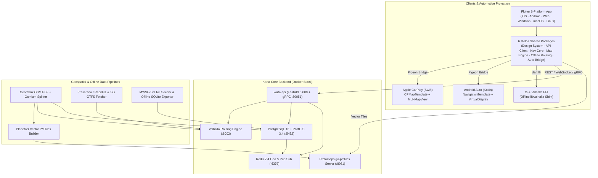

<p align="center">
  
</p>

<h1 align="center">Karta Navigation Platform</h1>

<p align="center">
  <strong>Dark-first cross-platform, offline-capable &amp; automotive navigation platform engineered for Malaysia (MY), Singapore (SG), and Brunei Darussalam (BN).</strong>
</p>

<p align="center">
  
  
  
  
  
</p>

---

## Overview

**Karta** is a full-stack, dark-first navigation monorepo built from the ground up for Southeast Asia's interconnected **Malaysia, Singapore, and Brunei** road networks. Rather than relying on mocked routing or opaque third-party black boxes, Karta integrates real **OpenStreetMap**, **PostGIS**, **Valhalla**, **Redis Geo / Pub/Sub**, **MapLibre**, and **PMTiles** across a 6-platform **Flutter** client and decoupled native **Apple CarPlay** & **Android Auto** projection modules.

### Key Highlights

- **Regional Toll & Currency Engine (MY / SG / BN)** — Automatic GPS-driven currency switching (`MYR` / `RM`, `SGD` / `$`, `BND` / `B$`) with real pre-route toll calculation and toll-free savings comparisons:
  - **Malaysia**: PLUS closed distance-matrix (`E1`/`E2` NSE, NKVE, ELITE — Touch 'n Go, SmartTAG, RFID, PLUS JustGO ANPR), open-barrier Klang Valley expressways (`LDP E11`, `SPRINT E23`, `DUKE E33`, `KESAS E5`, `AKLEH E12`, `SUKE E19`), Penang Bridge (`E36`), and MY–SG border checkpoints (BSI CIQ & Linkedua including RM 20.00 Road Charge).
  - **Singapore**: Time-varying LTA ERP gantry schedules across CTE, AYE, ECP/MCE, and CBD cordons.
  - **Brunei**: JKR Rasau / Sungai Teraban toll bridge & regional holiday schedules.
- **Multi-Modal & Offline-Ready Routing** — 7 Valhalla costing profiles (`drive_fastest`, `drive_avoid_tolls`, `drive_no_highways`, `drive_motorcycle`, `walk`, `cycle`, `transit` via RapidKL/Prasarana & SG GTFS), plus 6 downloadable regional offline packs (`.pmtiles` + `valhalla_tiles.tar` + offline SQLite tolls + local fuzzy POI index) with ~5 km cross-border overlap buffers and a C++ `libvalhalla` FFI shim.
- **Real-Time Crowdsourcing & Dynamic Rerouting** — Low-latency WebSocket (`/v1/realtime/ws`) and gRPC (`RealtimeHazardService` on `:50051`) backed by Redis Geo & geohash5 Pub/Sub for 6 canonical road hazards (`Police`, `Accident`, `Pothole`, `Stopped Vehicle`, `Road Debris`, `Road Closure`), community voting, live traffic-weight updates, and automatic ETA/toll-delta reroute proposals.
- **Hands-Free Regional Voice & Smart Commuter Suite** — Voice intent parser supporting **English, Bahasa Melayu, Manglish, and Singlish**, custom voice-pack recording studio, community fuel price comparison along routes, calendar-driven Time-to-Leave alerts (ICS), privacy-first carpool matching, and synced user accounts & saved places.
- **Native Automotive Projection (CarPlay & Android Auto)** — Strictly decoupled native **Swift (`KartaCarPlay` / `CPMapTemplate`)** and **Kotlin (`karta-android-auto` / `NavigationTemplate`)** modules bridged via strongly-typed Pigeon contracts, with offline MapLibre projection, left-hand traffic clockwise roundabout mapping, 1-tap distraction-compliant hazard reporting, volatile RAM-only GPS privacy scrubbing, and dynamic thermal FPS/3D-extrusion throttling.

---

## Brand & Design System

Karta ships with a dark-first automotive & desktop visual identity (`packages/karta_design_system`) and automatic Day/Night solar theme switching (`karta-dark-v1.json` & `karta-day-v1.json`):

| Token | Hex | Usage |
| :--- | :--- | :--- |
| **Deep Obsidian** | `#0D0F12` | Primary background & dark map canvas |
| **Charcoal Slate** | `#181C22` | Elevated surfaces, HUD cards & panels |
| **Muted Teal** | `#5B9A94` | Primary accent, active route & Karta brand pin |
| **Crisp Off-White** | `#F4F6F8` | Primary typography & maneuver glyphs |
| **Steel Gray** | `#8E96A0` | Secondary metadata, labels & captions |

Typography pairs **Plus Jakarta Sans** for clean UI legibility with **JetBrains Mono** for tabular speed, ETA, distance, and toll readouts.

---

## System Architecture



---

## What's Included in This Repository

### Monorepo Structure

```text
Karta/
├── apps/
│   └── karta_app/                 # Flutter 6-platform client (responsive mobile/tablet/desktop/web)
├── packages/
│   ├── karta_design_system/       # Dark/day theme tokens, highway signboards, toll badges, fonts, logo
│   ├── karta_api_client/          # Typed REST + WebSocket realtime client (IO / Web / Stub)
│   ├── karta_navigation_core/     # Headless GPS matcher, state machine, speed/thermal/privacy/voice core
│   ├── karta_map_engine/          # MapLibre controller (Native & Web), Look Around, tile prefetcher
│   ├── karta_offline_routing/     # dart:ffi Valhalla bridge, offline pack manager, local fuzzy POI search
│   └── karta_automotive_bridge/   # Bidirectional Pigeon IDL contracts for CarPlay & Android Auto
├── native/
│   ├── ios/KartaCarPlay/          # Standalone Swift Package (CPMapTemplate, MLNMapView, Voice, Thermal)
│   ├── android/karta-android-auto/# Standalone Kotlin Gradle library (androidx.car.app, offline PMTiles proxy)
│   └── cpp/valhalla_ffi/          # CMake C ABI wrapper around Valhalla's tyr::actor_t
├── services/
│   └── karta-api/                 # Python 3.12 FastAPI + gRPC server, PostGIS repos, toll & reroute engines
├── pipelines/
│   ├── osm2pgsql/                 # karta_flex.lua custom OSM Flex ingestion schema
│   ├── regions/                   # 6 MY/SG/BN GeoJSON polygons & regions_catalog.yaml
│   ├── scripts/                   # End-to-end 01–09 geospatial, GTFS, PMTiles, Valhalla & toll scripts
│   └── seed_data/tolls/           # MY PLUS matrix, Klang Valley open tolls, SG ERP schedules, BN tolls
├── contracts/
│   ├── openapi/                   # OpenAPI v1 specification (karta-v1.openapi.json)
│   └── proto/                     # gRPC Protobuf definition (karta_realtime.proto)
├── infra/
│   ├── docker/                    # docker-compose.yml (core stack + on-demand pipeline containers)
│   ├── maplibre/                  # karta-dark-v1.json & karta-day-v1.json vector map styles
│   ├── postgres/init/             # PostGIS DDL, country seeds, Phase 3 realtime & user/saved-places SQL
│   └── valhalla/                  # costing_profiles.json & valhalla.json.template
├── assets/logo/                   # Karta brand logo assets
├── scripts/                       # PowerShell task runner (karta.ps1) & web static server (serve_web.mjs)
├── Makefile                       # Linux/macOS orchestration targets
├── melos.yaml & pubspec.yaml      # Dart/Flutter Melos workspace configuration
└── .env.example                   # Environment template (copy to .env; secrets are gitignored)
```

### Feature Breakdown by Phase

| Phase | Scope | Included Modules & Capabilities |
| :---: | :--- | :--- |
| **Phase 1** | **Core Geospatial Backend & Pipelines** | FastAPI (`karta-api`), PostGIS 16/3.4, Redis 7.4 Geo, Valhalla routing with 7 profiles, `go-pmtiles`, Geofabrik OSM + `osmium` regional splitting, Planetiler PMTiles builder, RapidKL/SG GTFS ingestion, MY/SG/BN toll engine (`MYR`/`SGD`/`BND`), offline pack SHA-256 manifests. |
| **Phase 2** | **Cross-Platform Flutter App & Offline Core** | 6-platform Flutter app (`apps/karta_app`) + MapLibre GL JS Web bridge (`karta_map_bridge.js`), all 6 Melos packages, responsive Smartphone/Tablet/Desktop/Automotive shell, Google Maps-style POI & dropped-pin inspection, Street Look Around modal, solar Day/Night lighting, predictive corridor tile prefetcher, local fuzzy POI search, `native/cpp/valhalla_ffi` C++ shim. |
| **Phase 3** | **Real-Time Crowdsourcing, Voice & Commuter** | WebSocket + gRPC `RealtimeHazardService` (`:50051`), Redis geohash5 Pub/Sub, 6 hazard categories + radial report menu + voting/decay, dynamic traffic-weight injection & auto-reroute proposals, EN/BM/Manglish/Singlish voice intent parser, Custom Voice Pack Studio, community fuel prices along route, smart calendar Time-to-Leave (ICS), privacy-first carpool matching, user auth & saved places. |
| **Phase 4** | **Native Automotive, Privacy & Thermal** | Standalone Apple CarPlay Swift Package (`native/ios/KartaCarPlay`) & Android Auto Kotlin library (`native/android/karta-android-auto`), Pigeon bridge (`packages/karta_automotive_bridge`), clockwise LHT roundabouts, offline localhost `.pmtiles` HTTP Range proxy for Android Auto, companion turn-list overlay, zero-disk volatile RAM GPS privacy guard, and dynamic thermal FPS/3D shedding. |

### Downloadable Offline Regional Packs (`MY / SG / BN`)

| Region ID | Coverage | Countries |
| :--- | :--- | :---: |
| `my-peninsular-central` | Kuala Lumpur, Selangor, Putrajaya, Negeri Sembilan, Melaka | `MY` |
| `my-peninsular-north` | Penang, Perak, Kedah, Perlis, Kelantan, Terengganu, Pahang | `MY` |
| `my-peninsular-south` | Johor & MY–SG Causeway / Second Link buffer | `MY`, `SG` |
| `my-borneo` | Sabah, Sarawak, Labuan & Brunei transit buffer | `MY`, `BN` |
| `sg` | Singapore island-wide & Woodlands / Tuas Checkpoint buffer | `SG`, `MY` |
| `bn` | Brunei Darussalam incl. Temburong & Miri / Limbang border buffer | `BN`, `MY` |

---

## Core API Reference (`http://localhost:8000/v1` & gRPC `:50051`)

| Domain | Endpoints | Description |
| :--- | :--- | :--- |
| **Health** | `GET /v1/health`, `GET /v1/health/live` | Readiness across PostGIS, Redis Geo, Valhalla, and PMTiles |
| **Routing** | `POST /v1/routes` | Multi-modal routing, alternates, MY/SG/BN pre-route toll calculation & toll-free savings |
| **POIs & Spatial** | `GET /v1/pois/bbox`, `GET /v1/pois/search`, `GET /v1/pois/offline-index`, `GET /v1/spatial/road-context` | Redis Geo viewport POIs, PostGIS trigram search, GPS road/speed/lane/country context |
| **Tolls** | `GET /v1/tolls/gantries`, `POST /v1/tolls/estimate` | Regional toll gantry explorer & polyline6 toll estimator |
| **Offline & Tiles** | `GET /v1/regions`, `GET /v1/regions/downloads/{region_id}/{filename}`, `POST /v1/tiles/prefetch-plan` | Offline regional pack catalog/downloads & predictive corridor tile prefetching |
| **Real-Time & Hazards** | `WS /v1/realtime/ws`, `POST /v1/hazards`, `GET /v1/hazards/nearby`, `POST /v1/hazards/{id}/vote`, `POST /v1/hazards/traffic-probe` | Live hazard Pub/Sub, heading-aware queries, community confirmation & dynamic rerouting (also via gRPC `contracts/proto/karta_realtime.proto`) |
| **Voice & Packs** | `POST /v1/voice/parse-intent`, `GET/POST /v1/voice/packs`, `PUT/DELETE /v1/voice/packs/{pack_id}/clips/{cue_key}` | EN/BM/Manglish/Singlish voice intent parsing & custom voice-pack clip management |
| **Fuel** | `POST /v1/fuel/along-route`, `GET /v1/fuel/nearby`, `POST /v1/fuel/stations/{poi_id}/prices` | Community fuel price comparison along active route or nearby |
| **Smart Commuter** | `POST /v1/calendar/feeds`, `POST /v1/calendar/import-ics`, `GET/POST /v1/calendar/events`, `POST /v1/calendar/evaluate-departures`, `GET/POST /v1/carpool/offers`, `POST /v1/carpool/matches/search`, `POST /v1/carpool/offers/{id}/request`, `POST /v1/carpool/matches/{id}/respond` | Traffic-aware calendar Time-to-Leave & privacy-first carpool matching |
| **Users & Places** | `POST /v1/auth/register`, `POST /v1/auth/login`, `POST /v1/auth/logout`, `GET /v1/auth/me`, `GET/POST /v1/saved-places`, `DELETE /v1/saved-places/{place_id}` | Account authentication & synced Home/Work/favorite places |

Full OpenAPI specification: [`contracts/openapi/karta-v1.openapi.json`](contracts/openapi/karta-v1.openapi.json)
Realtime gRPC contract: [`contracts/proto/karta_realtime.proto`](contracts/proto/karta_realtime.proto)

---

## Quickstart

### Prerequisites

- **Docker Desktop** (for PostGIS, Redis, Valhalla, PMTiles, FastAPI, and data pipelines)
- **Flutter SDK** (`>= 3.24.0`) & **Dart SDK** (`>= 3.6.0`) for running the client and Melos packages
- **Optional (Native Automotive / FFI)**: Xcode (macOS) for `KartaCarPlay`, Android Studio / Gradle + Desktop Head Unit (DHU) for `karta-android-auto`, CMake + `vcpkg` for `valhalla_ffi`

### 1. Clone & Configure Environment

```bash
git clone https://github.com/MrHafizWilliams/Karta-Navigation.git
cd Karta-Navigation
cp .env.example .env
```

*(On Windows PowerShell, you can run `.\scripts\karta.ps1 env`.)*

### 2. Ingest Geospatial Data & Build Map/Routing Tiles

> **Note:** Large generated geospatial files (`data/`, `*.osm.pbf`, `*.pmtiles`, `valhalla_tiles.tar`) are gitignored and generated locally via the Dockerized pipeline.

**Windows PowerShell:**
```powershell
# Fast smoke build for Singapore (or use -Region all for full MY + SG + BN)
.\scripts\karta.ps1 postgis-load -Region sg
.\scripts\karta.ps1 pmtiles -Region sg
.\scripts\karta.ps1 valhalla-build -Region sg
```

**macOS / Linux (`Makefile`):**
```bash
make pipeline-sg        # Fast Singapore smoke pipeline
# or: make pipeline-central   (Klang Valley / Central Peninsular MY)
# or: make pipeline-full      (Full MY + SG + BN)
```

### 3. Boot the Backend Stack

Starts `karta-api` (`:8000` REST/WS, `:50051` gRPC), `valhalla` (`:8002`), `pmtiles` (`:8081`), `postgres` (`:5432`), and `redis` (`:6379`):

```powershell
# Windows
.\scripts\karta.ps1 up

# macOS / Linux
make up
```

### 4. Run the Flutter Client

```bash
flutter pub get
cd apps/karta_app
flutter run -d chrome   # or -d windows / -d macos / -d linux / iOS / Android
```

---

## Testing & Verification

### Backend (`pytest`)

```powershell
# Windows
.\scripts\karta.ps1 test-api

# macOS / Linux
make test-api
```

Covers API contracts, MYR/SGD/BND currency formatting, polyline6 geometry, costing profiles, MY/SG/BN toll engine calculations, Phase 3 realtime/commuter workflows, and UX data-layer optimizations.

### Flutter & Melos Packages (`flutter analyze` & `flutter test`)

```powershell
# Windows (analyzes & tests app + all 6 packages)
.\scripts\karta.ps1 flutter-test
```

Or via Melos:
```bash
melos run analyze
melos run test
```

### Native Automotive Integration

- **Apple CarPlay**: See [`native/ios/KartaCarPlay/README.md`](native/ios/KartaCarPlay/README.md) for Xcode Swift Package wiring, `com.apple.developer.carplay-navigation` entitlements, and CarPlay Simulator testing.
- **Android Auto**: See [`native/android/karta-android-auto/README.md`](native/android/karta-android-auto/README.md) for Gradle module integration and Google Desktop Head Unit (DHU) verification.
- **Offline C++ Valhalla FFI**: See [`native/cpp/valhalla_ffi/README.md`](native/cpp/valhalla_ffi/README.md) for CMake + `vcpkg` cross-compilation targets.

---

## Contributing & Engineering Standards

- **No Mocked Core Engines** — Routing, spatial queries, and toll lookups interface directly with real PostGIS, Valhalla, Redis Geo, and MapLibre implementations.
- **Strict UI / Automotive Decoupling** — Flutter UI widgets in `apps/karta_app` remain strictly decoupled from native GPS and CarPlay/Android Auto background services via `packages/karta_automotive_bridge`.
- **Privacy First** — Automotive projection stores hold GPS coordinates strictly in volatile RAM and scrub memory immediately on head-unit disconnect.
